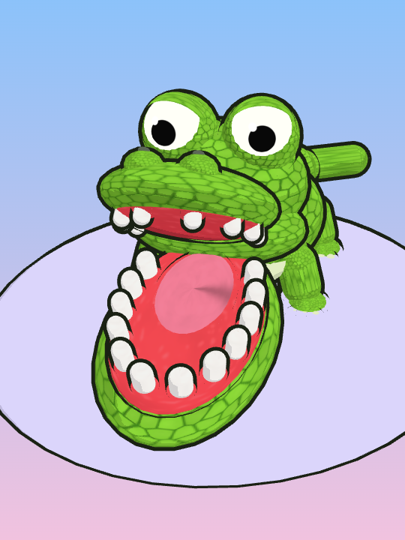

# Cocodrilo Dentista

Juego multijugador **P2P** para dos personas, hecho en **Godot 4 (GDScript)** e inspirado en el
clásico juguete del cocodrilo dentista. Por turnos, cada jugador presiona un diente del
cocodrilo; uno de ellos, elegido en secreto, hace que la boca se cierre de golpe. **Pierde quien
lo presiona.**

- **Sin servidor de juego.** Los dos dispositivos se conectan directamente por WebRTC. Para
  empezar, intercambian un código copiando y pegando (por WhatsApp, Telegram, correo...).
- **Android (APK)** y **Web (HTML5)** usan el mismo proyecto.
- Todo el arte, la música y los efectos **se generan por código**. No hay assets descargados.

<p align="center"></p>
<p align="center"><sub>Vista previa aproximada generada con three.js (<code>tools/vista_previa</code>). En Godot se ve
con su shader toon.</sub></p>

## Enlaces

| Versión | Enlace |
|---|---|
| Web (GitHub Pages) | <https://landaaa2777.github.io/CocodrileGame/> *(disponible cuando el CI se ejecute en la rama principal con Pages activado; ver [Publicar en GitHub Pages](#publicar-en-github-pages))* |
| APK para Android | Última release: <https://github.com/Landaaa2777/CocodrileGame/releases/latest>. Cada ejecución del CI también deja el artefacto `cocodrilo-dentista-apk` en la pestaña **Actions**. |

---

## Cómo jugar

1. **Menú.** Elige *Crear partida* (serás el anfitrión), *Unirse* (invitado), *Practicar* (contra
   un bot, sin conexión) u *Opciones* (volumen de música y de efectos).
2. **Conexión** (unos 30 segundos):
   1. El **anfitrión** pulsa *Crear partida*, espera a que aparezca su código y pulsa *Copiar código*.
      Luego se lo envía al rival por cualquier mensajería.
   2. El **invitado** pulsa *Unirse*, pega el código (*Pegar*), pulsa *Generar respuesta*, luego
      *Copiar respuesta*, y se la devuelve al anfitrión.
   3. El **anfitrión** pega la respuesta y pulsa *Conectar*.
   4. El anfitrión ve **«Esperando al rival...» → «Conectando...» → «¡Conectado!»**. El invitado ve
      «Esperando al rival...» hasta que el anfitrión pega su respuesta y luego «¡Conectado!». Entonces
      empieza la partida. Conviene devolver la respuesta en menos de un minuto: con el tiempo, los
      routers cierran el «agujero» de red que abrió el invitado.
3. **Partida.** El indicador de arriba muestra de quién es el turno (verde: tuyo; coral: del
   rival). Toca un diente y suéltalo encima para presionarlo. Si es seguro, se pone gris y sale
   «¡Uf, salvado!». Si es el mordedor... **¡ÑAM!** La música se vuelve más tensa conforme quedan
   menos dientes.
4. **Resultado.** Verás «¡Ganaste!» o «Perdiste». Para jugar otra vez, los dos pulsan *Jugar otra
   vez*. El marcador se mantiene durante la sesión.

---

## Cómo ejecutar

### Requisitos

- **Godot 4.7.x** (estable). El proyecto usa API estable de Godot 4 y funciona desde la 4.3.
- Para Android: **JDK 17**, **Android SDK** (build-tools y platform-tools) y las **plantillas de
  exportación** de tu versión de Godot.
- El **addon webrtc-native** para Android y escritorio (en web no hace falta):

  ```bash
  bash tools/instalar_webrtc.sh                                        # Linux, macOS o Git Bash
  powershell -ExecutionPolicy Bypass -File tools\instalar_webrtc.ps1   # Windows
  ```

  El script descarga `godot-extension-webrtc.zip` de
  [godotengine/webrtc-native](https://github.com/godotengine/webrtc-native/releases) (1.1.0) en
  `addons/`. Trae binarios Android **arm64-v8a** y **x86_64**.

### En el editor

1. Instala el addon (paso anterior). Sin él, en escritorio la conexión muestra «Falta el addon
   webrtc-native»; el modo *Practicar* funciona igual.
2. Abre `project.godot` con Godot 4.7 y espera a que importe los recursos.
3. Pulsa **F5**. La ventana de escritorio es vertical (450×800) para parecerse a un móvil.

### Pruebas

```bash
godot --headless --path . --import                                   # la primera vez
godot --headless --path . --script res://tests/ejecutar_pruebas.gd   # turnos, mordedor, código, escena
godot --headless --path . --script res://tests/prueba_red_local.gd   # 2 pares WebRTC reales (requiere el addon)
python3 tools/validar_escenas.py                                     # validación estática sin Godot
```

`tests/test_reglas_juego.gd` comprueba que los turnos se alternan, que no se puede jugar fuera
de turno ni repetir un diente, y que el diente mordedor siempre está entre los válidos (con 500
semillas).

---

## Fase 1: Android

### Generar el APK en tu equipo

1. Instala **JDK 17** y **Android SDK** (lo más sencillo es Android Studio; en el SDK Manager
   marca *Android SDK Build-Tools* y *Platform-Tools*).
2. En Godot: **Editor → Editor Settings → Export → Android** y rellena:
   - *Java SDK Path*: carpeta del JDK 17.
   - *Android SDK Path*: carpeta del SDK.
   - *Debug Keystore*: Godot la genera solo; si no, crea una con
     `keytool -genkeypair -keystore debug.keystore -storepass android -alias androiddebugkey -keypass android -keyalg RSA -validity 10000 -dname "CN=Android Debug,O=Android,C=US"`.
3. **Editor → Manage Export Templates → Download and Install**.
4. Instala el addon (`tools/instalar_webrtc.sh`).
5. **Project → Export → Android** (el preset ya existe: arm64-v8a, permiso `INTERNET`, iconos)
   → **Export Project** → `build/android/cocodrilo-dentista.apk`.
   Por línea de comandos: `godot --headless --export-debug "Android" build/android/cocodrilo-dentista.apk`.

Para una versión **release** crea tu propia clave (`keytool -genkeypair -keystore
cocodrilo-release.keystore -alias cocodrilo -keyalg RSA -keysize 2048 -validity 10000`) e indícala
en *Release Keystore* del preset. Godot la guarda en `.godot/export_credentials.cfg`, que no se
sube al repositorio. **Nunca subas `.keystore` ni contraseñas** (`.gitignore` ya los excluye).

### APK sin instalar nada: el CI

Cada push ejecuta `.github/workflows/ci.yml`, que descarga Godot, el addon y el SDK y genera
`cocodrilo-dentista-debug.apk`. Descárgalo en **Actions → (ejecución) → Artifacts →
cocodrilo-dentista-apk**. Si creas una etiqueta `v1.0.0`, el CI lo adjunta además a una Release.

### Instalar en el Samsung Galaxy S24

1. Pasa el APK al móvil (descárgalo desde el navegador del móvil o cópialo por USB).
2. Ábrelo desde *Mis archivos*. La primera vez Android pedirá permitir **«Instalar aplicaciones
   desconocidas»** para esa app; acéptalo.
   Con cable: `adb install -r cocodrilo-dentista-debug.apk`.
3. El S24 es **arm64-v8a**, la arquitectura que exporta el preset. Godot usa el renderizador
   Compatibility (OpenGL ES 3), que el S24 soporta de sobra.

### Probar la conexión

- **Dos móviles:** instala el APK en ambos. Uno pulsa *Crear partida*, el otro *Unirse* e
  intercambiáis los códigos por WhatsApp. Al cambiar de app para copiar y pegar, la conexión
  pendiente se mantiene.
- **Un móvil y el PC:** ejecuta el juego en el editor de Godot (con el addon) o abre la versión
  web en el navegador del PC. Para pasar los códigos, usa WhatsApp Web, Telegram Desktop o un
  correo a ti mismo.
- **Solo un dispositivo:** *Practicar* juega contra un bot que tampoco conoce el diente mordedor.

---

## Fase 2: Web

### Exportar

**Project → Export → Web** (el preset ya existe) → `build/web/index.html`, o por línea de comandos:
`godot --headless --export-release "Web" build/web/index.html`.

Ajustes del preset y por qué:

- `variant/thread_support=false`: exportación **sin hilos** (Godot 4.3 o superior). No necesita las cabeceras
  COOP/COEP (SharedArrayBuffer), que GitHub Pages no permite configurar.
- `html/experimental_virtual_keyboard=true`: permite escribir y pegar en los campos de código desde
  el móvil.
- Se excluye `addons/webrtc*`: en el navegador `WebRTCPeerConnection` lo implementa el propio
  navegador. `Red` usa la misma interfaz en las dos plataformas y detecta la web con
  `OS.has_feature("web")`.
- El botón *Pegar* usa `navigator.clipboard.readText()` (vía `JavaScriptBridge`); el navegador
  pedirá permiso la primera vez. Por eso hace falta **HTTPS**, que GitHub Pages ya ofrece.
- **Audio en web:** los navegadores no dejan sonar nada hasta la primera interacción. El menú
  muestra «Toca la pantalla para activar el sonido», y la música arranca desde el principio al
  primer toque, clic o tecla (`Audio.desbloqueado`).

Para probarlo en local, sírvelo con un servidor web (no abras el archivo directamente):
`python3 -m http.server -d build/web 8000` y entra en <http://localhost:8000>. En `localhost` el
portapapeles funciona sin HTTPS.

### Publicar en GitHub Pages

1. En GitHub: **Settings → Pages → Build and deployment → Source: GitHub Actions**.
2. Fusiona esta rama en la rama principal (o haz push a ella). El job **«Publicar en GitHub
   Pages»** del CI exporta y despliega la web en
   **<https://landaaa2777.github.io/CocodrileGame/>** (HTTPS obligatorio para WebRTC y el portapapeles).
3. Para publicar también el APK: `git tag v1.0.0 && git push origin v1.0.0` crea una Release con
   `cocodrilo-dentista.apk` y `cocodrilo-dentista-web.zip`.

### Probar con dos pestañas o dispositivos

- **Dos pestañas:** abre la URL dos veces. En la primera, *Crear partida* → *Copiar código*. En la
  segunda, *Unirse* → *Pegar* → *Generar respuesta* → *Copiar respuesta*. Vuelve a la primera,
  *Pegar* → *Conectar*.
- **Web y APK** también pueden jugar entre sí: el protocolo y el formato del código son los mismos.

---

## Cómo funciona la conexión P2P

`autoload/red.gd` (autoload **Red**) encapsula WebRTC:

```
ANFITRIÓN                                         INVITADO
create_data_channel(negotiated, id=1)
create_offer() → set_local_description("offer")
… recolecta candidatos ICE …
get_gathering_state() == COMPLETE  →  código A ──► unirse(A)
                                                  create_data_channel(negotiated, id=1)
                                                  set_remote_description("offer") + add_ice_candidate × N
                                                  → respuesta automática → set_local_description("answer")
                                                  … recolecta candidatos ICE …
aceptar_respuesta(B) ◄────────────────── código B  COMPLETE
set_remote_description("answer") + add_ice_candidate × N
… ICE conecta … canal de datos STATE_OPEN en ambos → «Conectado»
```

- **Código de conexión:** JSON `{"v", "tipo", "sdp", "candidatos": [{"media", "indice", "nombre"}]}`
  en base64. Al pegarlo se eliminan espacios, saltos de línea y comillas que añaden algunas apps.
- **Canal negociado** con `id = 1`: ambos lados lo crean antes de la oferta/respuesta.
- **STUN:** `stun:stun.l.google.com:19302`.
- **Fin de la recolección ICE:** no hay señal. Se consulta `get_gathering_state()` cada frame tras
  `poll()` y, al llegar a `COMPLETE`, se esperan 2 frames más para recoger los candidatos que el
  hilo nativo haya dejado en cola. No es un temporizador fijo; solo hay un límite de seguridad de
  25 s por si la recolección nunca termina.
- **Autoridad del anfitrión:** el anfitrión elige el mordedor en secreto (`ReglasJuego`) y
  arbitra. El invitado solo envía `jugada {diente}`. El anfitrión valida que sea el turno del
  invitado, que el diente exista y que no se haya usado. Si todo es correcto, envía `resultado`
  (que también usa para sus propias jugadas); si no, envía `rechazo`. Los números que llegan por
  JSON (float) se convierten con `Protocolo.a_entero()`.
- **Mensajes** (`scripts/protocolo.gd`): `listo`, `inicio`, `jugada`, `resultado`, `rechazo`,
  `apunta` (el rival ve qué diente estás pensando), `revancha`, `revancha_ok` y `salir`, más
  latidos cada 2 s para detectar desconexiones.

## Limitaciones conocidas

- **El anfitrión puede hacer trampa.** En P2P sin servidor, el dispositivo del anfitrión conoce
  el diente mordedor. Para dificultarlo, al empezar cada ronda publica `sha256("diente:sal")` y al
  final revela el diente y la sal. El invitado ve «✔ El anfitrión no cambió el diente mordedor» o
  un aviso si cambió. Esto detecta que el mordedor se cambie a mitad de ronda, pero **no impide**
  que un anfitrión con una versión modificada del juego sepa cuál es.
- **TURN:** solo se usa STUN. En algunas redes móviles (NAT simétrico o CGNAT estricto) y redes
  corporativas la conexión directa falla («No se pudo conectar... necesitarían un servidor TURN»).
  Solución: probar con Wi-Fi, o añadir un servidor TURN propio en `SERVIDOR_STUN` /
  `iceServers` de `red.gd`, con sus credenciales fuera del repositorio.
- Entre **navegador y APK en la misma Wi-Fi**, el navegador oculta su IP local (mDNS `.local`), así
  que se usa la ruta por la IP pública y el router debe permitir *hairpinning*. Si falla, prueba con
  datos móviles en uno de los dos.
- Si una app pasa más de unos 20 s en segundo plano durante la partida, el rival da la conexión
  por perdida.
- Los dos jugadores deben usar la misma versión del juego (se comprueba al conectar).

---

## Cómo se generaron los assets

No hay ningún archivo descargado: todo se crea con estos scripts (Python 3 con `numpy` y `Pillow`):

```bash
pip install numpy pillow
python3 tools/generar_texturas.py    # → assets/texturas/
python3 tools/generar_audio.py       # → assets/audio/
python3 tools/generar_cocodrilo.py   # → escenas/cocodrilo.tscn, escenas/diente.tscn
```

**Texturas** (`assets/texturas/`):

- `escamas_albedo.png`: diagrama de Voronoi repetible sin costuras, con filas alternas
  desplazadas (patrón de escamas), tono distinto por escama y grietas verde oscuro.
- `escamas_altura.png` y `escamas_normal.png`: mapa de alturas (grietas hundidas y escamas
  abombadas) convertido en mapa normal con derivadas centrales (`np.roll`, sin costuras;
  convención OpenGL, la de Godot).
- `encia_albedo.png`: gradiente rojo coral, más oscuro hacia la garganta, con ruido fractal
  sutil. El brillo húmedo lo pone el shader (especular nítido y satinado alto).
- `lengua_albedo.png`: rosa con surco central.
- `dientes_albedo.png`: blanco cálido con gradiente marfil hacia la base.
- `ojo_pupila.png`: pupila negra con iris verde muy oscuro. El shader `ojo.gdshader` la proyecta
  sobre la esfera blanca, la desplaza según la mirada y añade el reflejo especular fijo.
- `icono*.png`: icono de la app dibujado con Pillow (incluidas las capas del icono adaptativo).

**Audio** (`assets/audio/`, WAV mono de 16 bits):

- **Xilófono:** senos con los parciales de una lámina (1 : 3,93 : 9,2) y caída exponencial rápida.
- **Ukelele:** cuerda pulsada **Karplus-Strong** (afinación GCEA), rasgueos con desfase entre cuerdas.
- **Batería:** bombo (seno con caída de tono 150 → 45 Hz), palmas (ráfagas de ruido filtrado),
  shaker y caja.
- `musica_menu.wav`: 72 s en do mayor a 120 BPM (I-vi-IV-V), xilófono, ukelele, bajo, bombo y palmas.
- `musica_partida.wav` + `musica_partida_tension.wav`: 51 s en la menor a 132 BPM. La capa de
  tensión (latido, hi-hats, trémolo disonante y redobles) va sincronizada con la base, y su
  volumen y el tempo suben conforme quedan menos dientes (`Audio.establecer_tension`).
- SFX: clic en diente, *hover*, tic de tensión, gruñido de anticipación, *chomp*, fanfarria de
  victoria, trombón de derrota, «¡Uf, salvado!» (soplido con formante de «u» y un tintineo),
  botón, transición y conectado.
- Las pistas se renderizan «en círculo» (la cola del final se suma al principio) y llevan un
  bloque `smpl` con los puntos de bucle, que Godot detecta al importar.
- **Buses:** Master → Musica y SFX (`default_bus_layout.tres`). Los volúmenes se guardan en
  `user://ajustes.cfg`.

**Modelo:** el cocodrilo está hecho con esferas y cápsulas de Godot en una escena reutilizable
(`escenas/cocodrilo.tscn`). Los nodos tienen nombres claros: `Cabeza`, `Maxilar`, `Mandibula`,
`Ojos`, `Dientes`, `Cola`... Así puedes sustituir las primitivas por un `.glb` sin tocar los scripts.
Los 12 dientes jugables están en la mandíbula inferior, como en el juguete; la hilera superior es
decorativa. **Estilo:** shader toon (`shaders/toon.gdshader`) con escalones de luz, brillo
satinado y luz de borde, más contorno por casco invertido (`shaders/contorno.gdshader`).

## Animaciones

Todas usan `Tween` con curvas de aceleración, o senos continuos en `_process`:

- **Reposo:** respiración (escala Y), parpadeo aleatorio cada 2 a 5 s (a veces doble) y cola en
  dos segmentos con desfase.
- **Ojos:** las pupilas siguen el ratón o el dedo, proyectado en un plano delante del cocodrilo.
- **Dientes:** al apuntar crecen y rebotan (squash and stretch); al presionarlos se hunden y dan
  una sacudida; si son seguros, se ponen grises y dan un saltito con el globo «¡Uf, salvado!»;
  el mordedor destella en rojo.
- **Mordida:** anticipación (la cabeza se tensa y tiembla, los ojos se entrecierran, el maxilar
  toma impulso y la mandíbula sube un poco), cierre en 0,1 s con `TRANS_EXPO`/`EASE_IN` y rebote,
  screen shake por trauma, chispas, destello y squash and stretch de 0,3 s.
- **Resultado:** pose feliz con saltitos y confeti, o caída con aplastamiento, ojos en X y
  balanceo mareado.
- **Interfaz:** barrido de color entre pantallas, textos y botones que entran escalando desde 0
  con rebote, y botones que se encogen al pulsarlos.

## Estructura

```
autoload/      red.gd (Red), audio.gd (Audio), transicion.gd (Transicion)
escenas/       menu, conexion, partida, resultado, cocodrilo, diente, escenario
scripts/       lógica de pantallas, reglas_juego.gd, protocolo.gd, portapapeles.gd, cocodrilo.gd…
shaders/       toon, contorno, ojo, cielo, transicion
materiales/    materiales .tres y entorno
assets/        texturas/ y audio/ generados
tests/         pruebas headless
tools/         generadores, validador, scripts de CI e instalación del addon (ignorado por Godot)
docs/FASE0.md  versión, cambios de API y qué se validó dónde
```

## Créditos

Ver [CREDITS.md](CREDITS.md). En resumen: todos los assets son originales y están generados por
código. «Cocodrilo Dentista» es un nombre genérico; el logotipo y el diseño son propios y no usan
el nombre, el logotipo ni la tipografía de ningún producto comercial.
